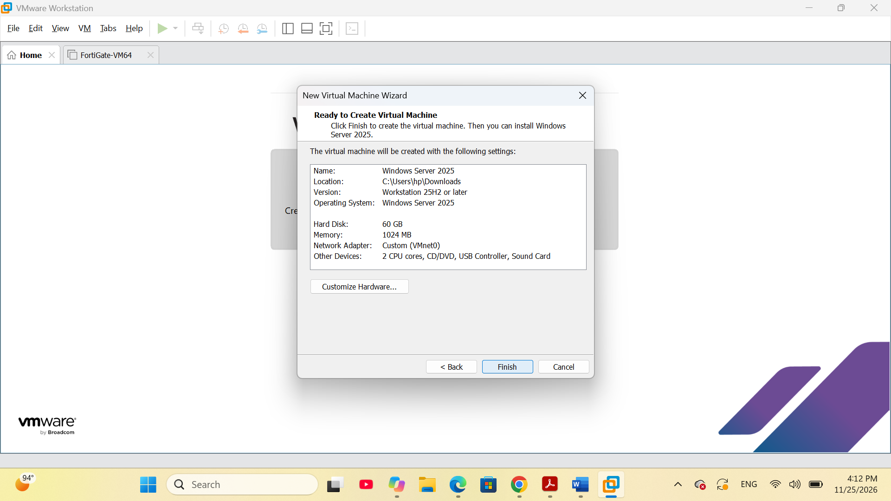
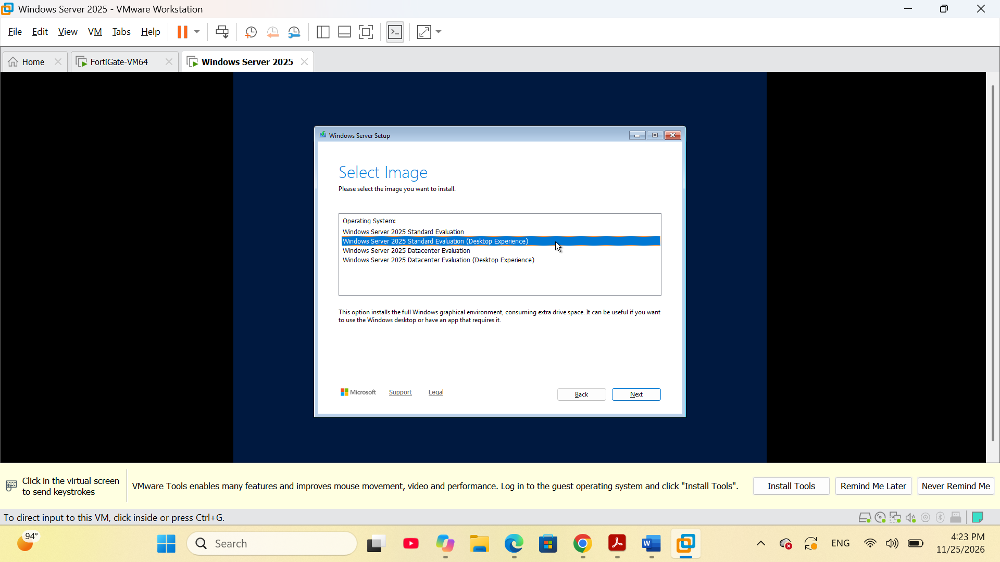
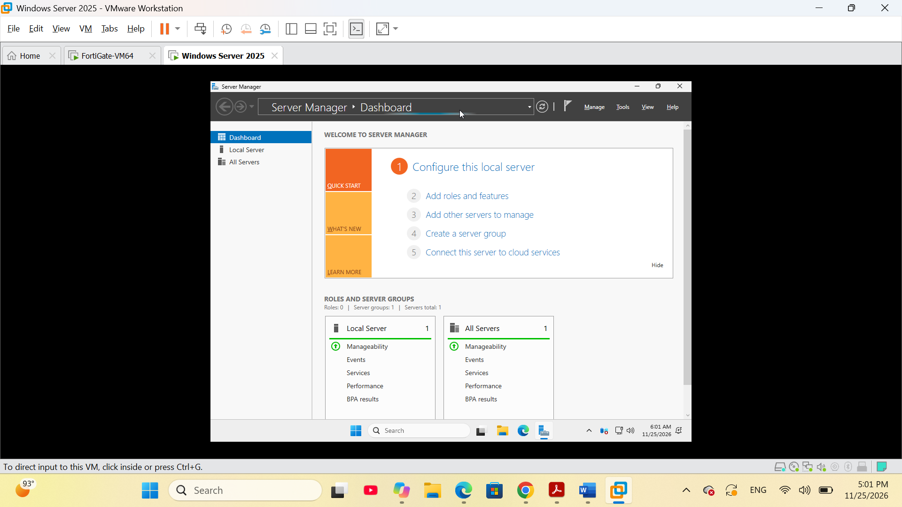
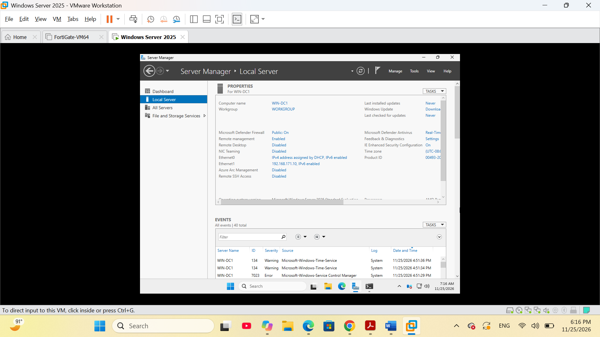

Windows Server 2025 – Active Directory Home Lab

This project documents the setup and configuration of a Windows Server 2025 lab environment using VMware Workstation.
The objective is to build a practical IT infrastructure environment and gain hands-on experience with Windows Server administration, Active Directory, DNS, DHCP, and Group Policy.
Lab Environment
Virtualization: VMware Workstation
Operating System: Windows Server 2025 Standard Evaluation
Installation: Desktop Experience
Server Name: WIN-DC1
Network Configuration
The server uses two virtual network adapters:
Adapter	Network Type	IP Address
Adapter 1	NAT	DHCP
Adapter 2	Host-only	192.168.171.10
Host-only Subnet: 192.168.171.0/24
Subnet Mask: 255.255.255.0
Completed Tasks
Installed Windows Server 2025 Standard Evaluation.
Selected Desktop Experience.
Renamed the server to WIN-DC1.
Configured two VMware network adapters.
Assigned a static IP address to the Host-only network adapter.
Upcoming Tasks
Install Active Directory Domain Services (AD DS).
Configure DNS.
Promote the server to Domain Controller.
Create a new Active Directory domain.
Create Organizational Units and user accounts.
Configure DHCP.
Join client computers to the domain.
Implement Group Policy Objects (GPOs).
Test domain connectivity and authentication.
Project Documentation
Screenshots and configuration details will be added as the project progresses.
Project Status
Phase 1: Windows Server Installation and Initial Network Configuration – Completed.

Markdown

## Screenshots Documentation

1. Windows Server Installation

2. Server Configuration

3. Server Manager

4. Network Configuration

